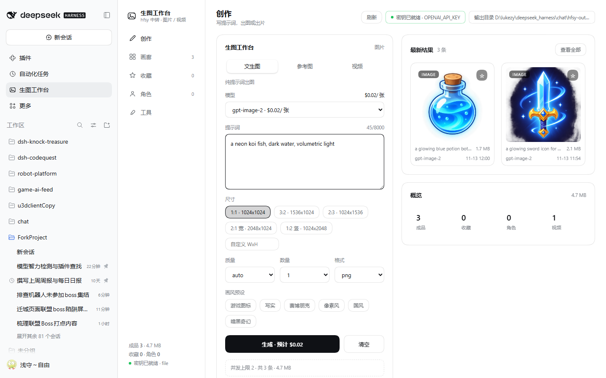
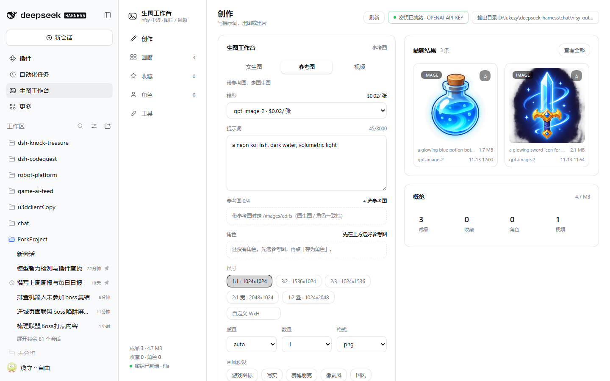
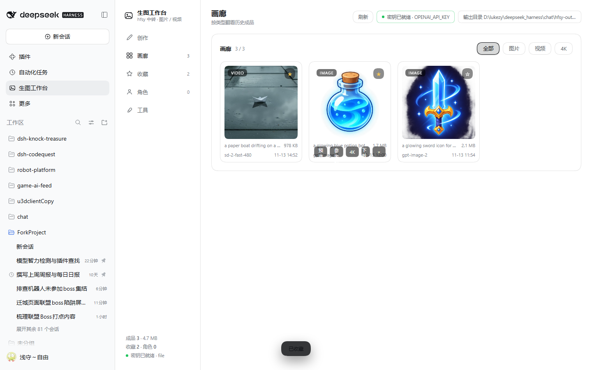
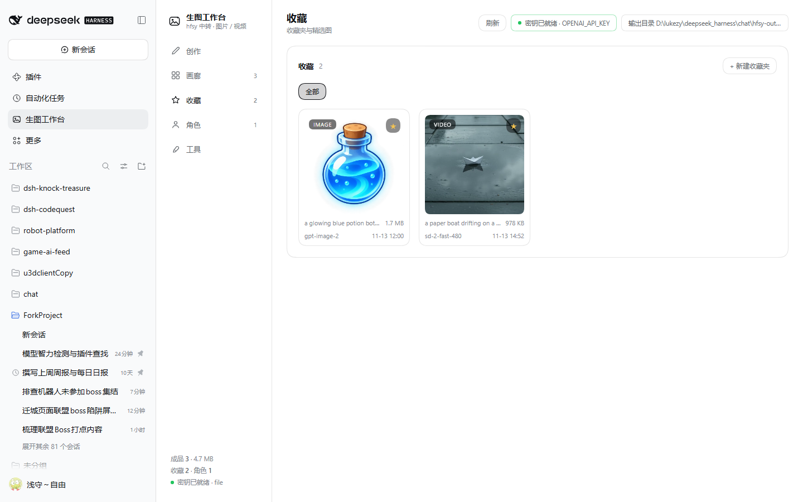
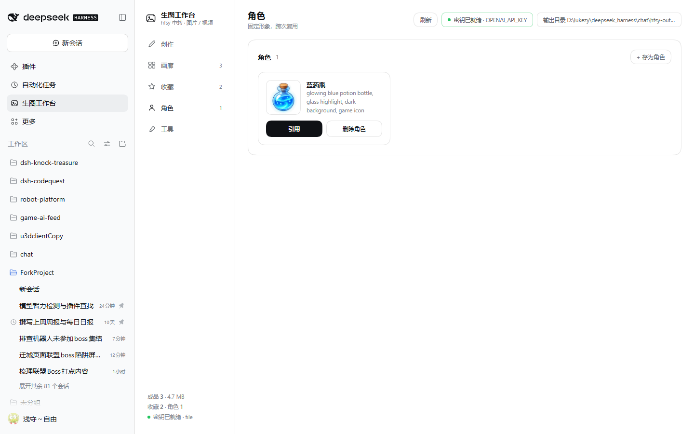
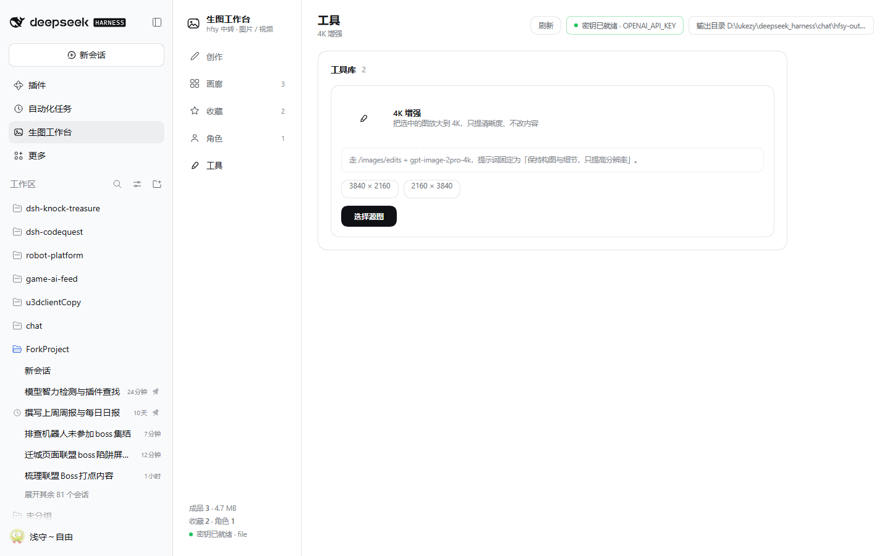

# dsh-hfsy-studio

把 hfsy 中转的**生图 / 生视频**调用包成 DeepSeek Harness 里的一个可视化工作台：
侧栏点「生图工作台」→ 自带一条竖向导航（创作 / 画廊 / 收藏 / 角色 / 工具）+ 分区页签。
出图直接落到本地目录，历史可回看、可下载、可复制路径。



| 参考图 / 角色 | 画廊分类 |
| --- | --- |
|  |  |

| 收藏夹 | 角色卡 | 工具库 |
| --- | --- | --- |
|  |  |  |

## 界面结构

```
┌ 侧栏导航 ─┬ 页头（视图标题 · 刷新 · 密钥 · 输出目录）
│ 创作      │
│ 画廊      │   创作页：[参数卡] [最新结果 + 概览]
│ 收藏      │   其它页：单卡 + 页签筛选
│ 角色      │
│ 工具      │
└───────────┴ 底部：成品数 / 收藏 / 角色 / 密钥状态
```

## 它能做什么

| 能力 | 说明 |
| --- | --- |
| 三栏工作台 | 左侧竖向导航 + 页头操作区 + 内容卡片；创作页是「参数卡 | 任务/结果」双栏，卡片 20px 圆角、留白 20px，不再挤成一列 |
| 模式页签 | 创作页顶部三档：文生图 / 参考图 / 视频，切换即换整套参数（视频换成时长 + 清晰度） |
| 分类画廊 | 画廊页顶部四档筛选：全部 / 图片 / 视频 / 4K，独立成页展示，不再塞在右栏 |
| 参数面板 | 模型（下拉里直接带单价）、提示词（Ctrl+Enter 生成）、尺寸预设 / 自定义 WxH、质量、数量、格式；视频走时长 + 清晰度 |
| 结果画廊 | 本次任务进度（阶段 + 计时 + 取消）、成品瀑布流、点开灯箱、下载、复制落盘路径、删除记录 |
| 失败可见 | 失败/取消的任务停在「失败 / 已取消」区，原样显示中转返回的错误，可手动关闭 |
| 本地落盘 | 默认 `hfsy-output/<日期>/<时分秒>-<id>-<提示词>.png`，历史写在 `hfsy-output/history.json` |
| 历史持久 | 重启 DSH 后历史仍在（磁盘文件 + history.json 双份） |
| 收藏 | 画廊里点 ☆ 收藏，可按收藏夹分组；收藏的图能一键「用作参考图」 |
| 参考图 / 图生图 | 从历史或收藏挑最多 4 张参考图，带参考时自动走 `/images/edits`（multipart），不再走纯文生图 |
| 角色库 | 把当前参考图存成角色（名字 + 外貌描述），下次勾选角色即可复用同一形象，描述会自动写进提示词 |
| 工具库 | 只保留「4K 增强」：选一张图，用 `gpt-image-2pro-4k` 放大到 3840×2160 / 2160×3840 |
| 价格展示 | 自动读中转的 `/api/pricing`：下拉里每个模型带单价，选中后显示「$0.75/秒 · 5s ≈ $3.75」，生成按钮也带本次预计花费 |
| 视频可出片 | 走中转的 `/video/create` + `/video/query`，按秒计费，2~5 分钟出片，成品落盘 mp4 并可在工作台里播放 |
| 密钥隔离 | 密钥只在宿主进程里解析，浏览器永远拿不到；路由只接受同源请求 |

## 安装

桌面端 profile 由 Electron 独占管理，不能用 CLI 改，所以走界面：

1. 打开 **设置 → 插件 → 安装第三方插件**（添加插件）
2. 填本机目录：`D:\lukezy\deepseek_harness\chat\dsh-hfsy-studio`
3. 装完刷新页面，左侧栏出现「生图工作台」

> 本地目录安装是**拷贝快照**：以后改了 `index.js` / `client.js`，卸载重装一次才会生效。
> 想在 web profile 里边改边试，可以用 `dsh plugin --profile web add file:<dir>`，再重载页面。

## 配置

改 `~/.dsh/profiles/<profile>/cordis.patch.yml` 里这一行（或直接改本包自带的 `cordis.patch.yml` 后重装）：

```yaml
- id: hfsy-studio
  name: dsh-hfsy-studio
  config:
    baseUrl: https://www.hfsyapi.cn/v1   # OpenAI 兼容根地址，末尾不带 /
    apiKeyEnv: OPENAI_API_KEY            # DSH 凭据名，取不到时回落到同名环境变量
    outputDir: D:/lukezy/deepseek_harness/chat/hfsy-output
    imageModels: [gpt-image-2, gpt-image-2.5, gpt-image-2.6, gpt-image-2pro, gpt-image-2pro-4k]
    videoModels: [sd-2-fast-480, sd-2-fast-720, sd-2.5-480, sd-2.5-720, wan-3.0-480, wan-3.0-720, minimax-h3]
    maxConcurrent: 2                      # 同时最多几个任务
    # requestTimeoutMs: 240000            # 单次请求超时
    # maxRetries: 2                       # 网络 / 429 / 5xx 重试次数
    # videoPollMs: 5000                   # 视频任务轮询间隔
    # videoTimeoutMs: 1800000             # 视频总等待上限（默认 30 分钟）
    # pricingTtlMs: 600000                # 价目表缓存时间，页面「刷新」会强制重拉
    # currencySymbol: $                   # 中转 /api/pricing 的金额单位
    # maxRefs: 4                          # 单次最多几张参考图
    # upscaleModels: [gpt-image-2pro-4k, gpt-image-2pro]   # 工具库「4K 增强」可用模型
```

密钥：DSH 凭据里已有 `OPENAI_API_KEY`（就是 hfsy 的 key）时页头会显示「密钥已就绪 · 来源: file」；没有就显示黄色告警。

## 接口一览（宿主侧）

| 方法 | 路径 | 作用 |
| --- | --- | --- |
| GET | `/hfsy-studio/api/state` | 配置、可用模型、价目表、最近任务、历史、统计 |
| POST | `/hfsy-studio/api/pricing/refresh` | 强制重拉中转价目表 |
| POST | `/hfsy-studio/api/generate` | 提交任务 `{kind, model, prompt, size, quality, count, format, duration, resolution, refs, characters, tool}`；`refs` 非空即图生图，`tool: 'upscale'` 走 4K 增强 |
| POST | `/hfsy-studio/api/jobs/<id>` | 取消任务 |
| POST | `/hfsy-studio/api/history/delete` · `/history/clear` | 删一条 / 清空历史（不动磁盘文件） |
| POST | `/hfsy-studio/api/favorites/add` · `/remove` · `/move` · `/folder` | 收藏一张图 / 取消 / 换收藏夹 / 建·改名·删收藏夹 |
| POST | `/hfsy-studio/api/characters/save` · `/delete` | 保存或删除角色（名字 + 描述 + 参考图） |
| GET | `/hfsy-studio/api/models` | 拉中转 `/models` 并按图/视频分类 |
| GET | `/hfsy-studio/api/file?rel=` | 回读落盘文件（限定在 outputDir 内，防路径穿越） |
| POST | `/hfsy-studio/api/open-output` | 打开输出目录 |

所有路由都做同源校验（`Origin`/`Sec-Fetch-Site`），跨站请求直接 403。

## 开发与验证

```powershell
node --check index.js
node --check client.js
node test/smoke.mjs               # 状态 / 价目表 / 参数校验 / 路径穿越，不花钱
node test/smoke.mjs --live        # 真调一次 gpt-image-2 并落盘到 test/output
node test/smoke.mjs --live-video  # 真出一段 4s/480p 视频（sd-2-fast-480），约 2~4 分钟
node test/client.mjs              # 用假 React 跑工厂 + 渲染面板，验证插槽注册
```

已验证（2026-11-13）：

- `smoke.mjs --live`：真实出图 1254×1254 / 1.1 MB / 30.3s，`/file` 可回读，`history.json` 已写。
- `smoke.mjs --live-video`：`sd-2-fast-480` 4s 出片成功，mp4 落盘、`/file` 回读 `video/mp4`。
- 参数直连验证：`/video/create` 接受 `{model, prompt, resolution, duration}`，`/video/query?id=` 返回 `data.detail.url` 与 `progress`。
- 价格核对：中转 `/api/pricing` 里 `gpt-image-2 = $0.02`，实测一次出图计费正好 `2`（美分），单位一致。
- `client.mjs`：假 React 渲染出的组件树 100+ 节点、`hs-root` 外壳、样式只注入一次。
- `smoke.mjs --live-edit`：真跑通「收藏 → 存角色 → 带参考图生图（39s）→ 4K 增强（3840×2160 / 1.5 MB）」，`favorites.json` / `characters.json` 均已落盘。
- 中转侧直连验证：`/images/edits` 支持 `image[]` 多参考图；`gpt-image-2pro-4k` + `size=3840x2160` 返回真 4K。
- 真实 dsh 实例里打开页面：侧栏入口、面板渲染、UI 内出图、灯箱、失败卡片均正常。

未验证：多图并发出图、`open-output` 在非 Windows 平台的表现。

## 目录

```
index.js            宿主：路由 + 出图/出片引擎 + 落盘 + 历史
client.js           浏览器：侧栏入口 + 工作台页面（React，纯 theme token）
cordis.patch.yml    bundle 补丁与默认配置
locale/{zh,en}.json 插件市场里显示的标题/描述
icon.svg            插件图标
assets/preview*.png 界面截图
test/               smoke / client 两个独立测试
```

## 注意

- 视频走 `/video/create` + `/video/query`（按秒计费）；`/video/generations` 在这台中转上会报 `invalid_api_platform`，别走那条。
- `/models` 里列出的视频模型不等于能用：`Doubao-Seedance-*` 未配价格，`muse-video` 没有通道，真正能跑的是 `sd-*` / `wan-3.0-*` / `minimax-h3` 这批。
- 出图模型走 `/images/generations`；MJ 系（`mj_imagine`）协议不同，本版未接。
- 历史只记元数据，删除记录不会删磁盘文件；收藏和角色分别存在 `favorites.json` / `characters.json`。
- 中转有时同时返回 `b64_json:""` 和 `url`，空的 b64 不能当结果（踩过，已修）。
- MJ 系、PSD/动画/素材提取这类工具这次没有迁（只保留 4K 增强）。